<div align="center">


# Charge Log

**A simple, good-looking log for electric car charging.**
Record each charge in a few taps and see what you spend, how much energy you use and how efficient your cars are.

[**Open the app**](https://davitos223.github.io/charge-log/) · [Windows app](https://github.com/davitos223/charge-log/releases/latest)

<br>

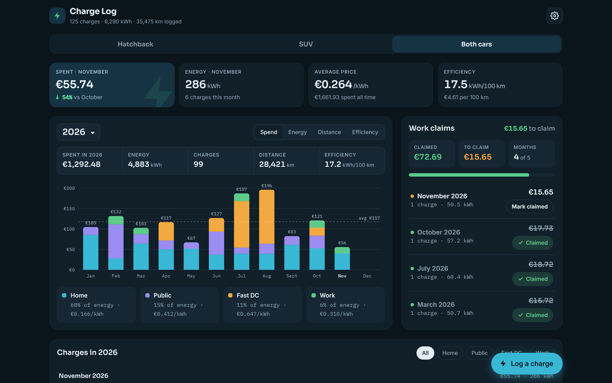

<br><br>

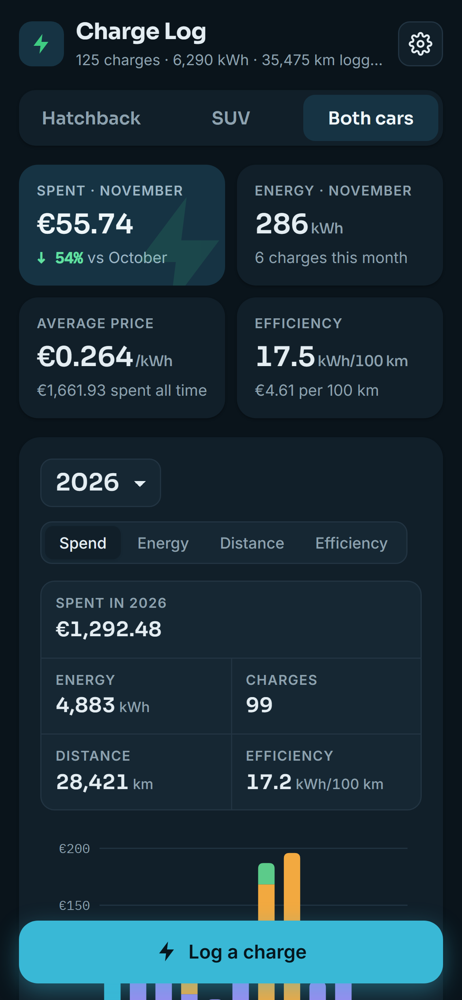&nbsp;
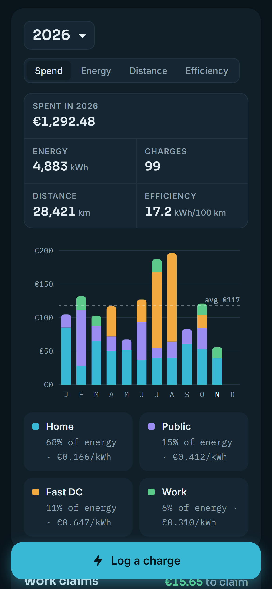&nbsp;
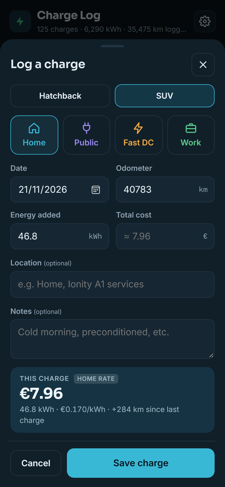&nbsp;
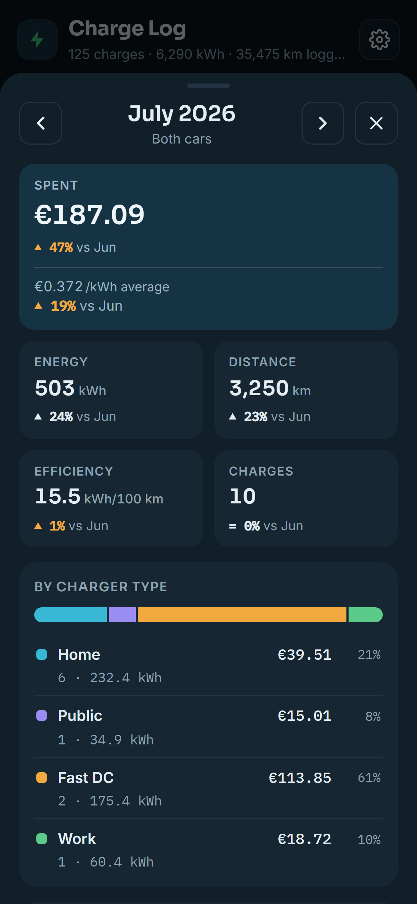

<sub>Screenshots use made-up demo data.</sub>

</div>

---

## Contents

- [Features](#features)
- [A tour of the app](#a-tour-of-the-app)
- [Getting the app](#getting-the-app)
- [Updates](#updates)
- [Your data](#your-data)
- [How it works](#how-it-works)
- [For developers](#for-developers)

## Features

- **Quick logging**: car, charger type, date, odometer, kWh and cost, built for one-handed use at the charger, with a live summary of the cost, price per kWh and distance since the last charge
- **Typo checks**: a future date, an odometer that goes backwards or jumps, or more than a full battery gets a second look before saving
- **Home, Public, Fast DC and Work** charger types, each with its own colour
- **Several cars**: switch between cars or see them together
- **Year view**: pick a year and the chart, totals and charge list follow
- **Charts**: spend, energy, distance and efficiency per month as stacked bars, side by side, share of each month, horizontal bars or a running total, with the monthly average marked
- **Month details**: tap a month for its full page, with comparisons to the month before and the same month last year, the split by charger type and car, the work claim and every charge
- **Efficiency per car** (kWh/100 km) to see seasonal changes and spot missed entries
- **Work claims**: monthly totals of work charging, ticked off once paid back, with the year's claimed and outstanding amounts
- **Home electricity price history**: a new price from a chosen month onwards, with each charge priced by its own date
- **Sync between devices**, and one list can be shared by several people with their own logins
- **Works offline**: charges logged without signal upload when the connection returns, and the app opens even when GitHub is down
- **Phone, tablet and desktop layouts**, light and dark themes, and a choice of colours
- **Backup** to a JSON file at any time

## A tour of the app

### At a glance

The top of the app answers the everyday questions: what this month cost compared with last month, how much energy went in, the average price per kWh and how efficient the cars are. Pick one car or see both together.

<p align="center">
&nbsp;&nbsp;
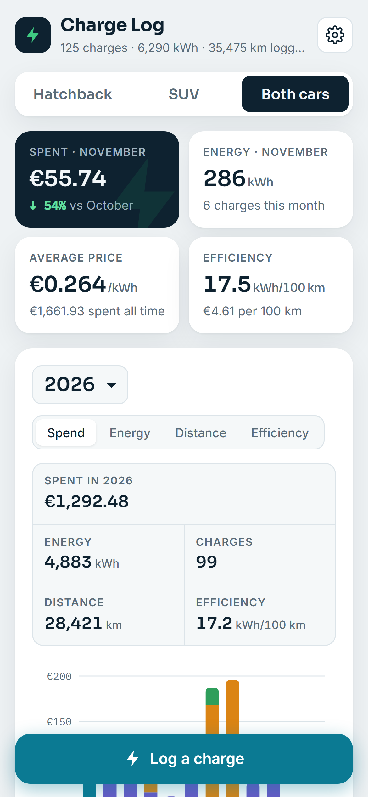
</p>

### Charts that explain the month

Each bar is split by where the charging happened. Hover over a month on a computer for a quick breakdown, or switch between spend, energy, distance and efficiency. Months with no charges show a small dash, so a quiet month never looks like missing data.

<p align="center">
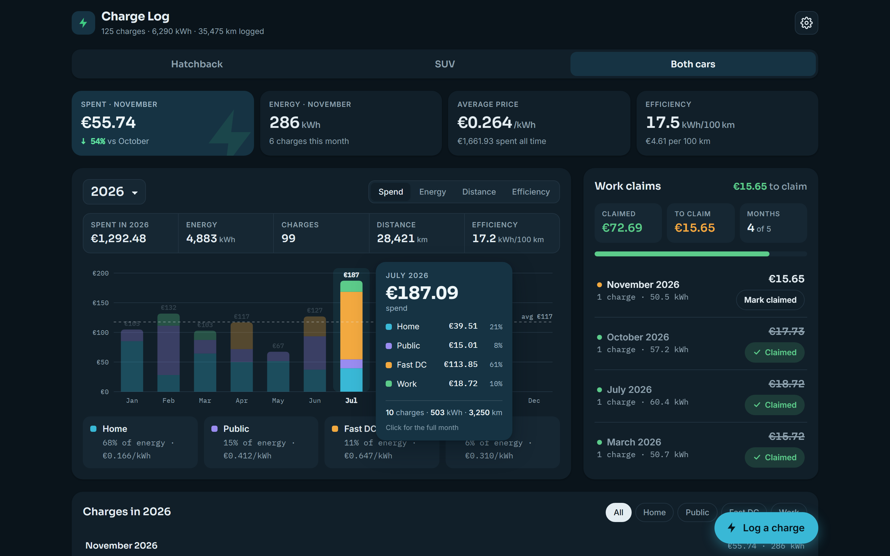
</p>

<table>
<tr>
<td width="50%">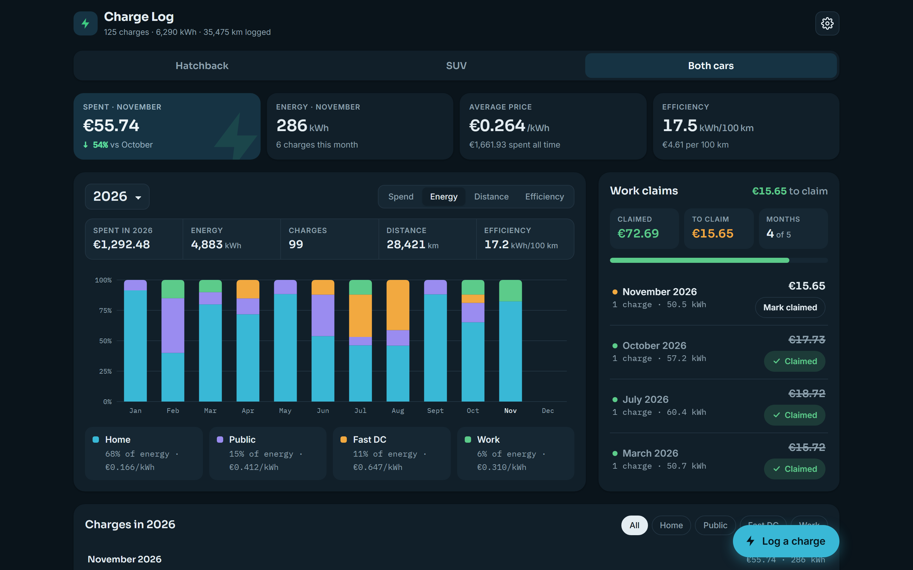<br><sub><b>Share</b> shows each month as 100%, here for energy</sub></td>
<td width="50%">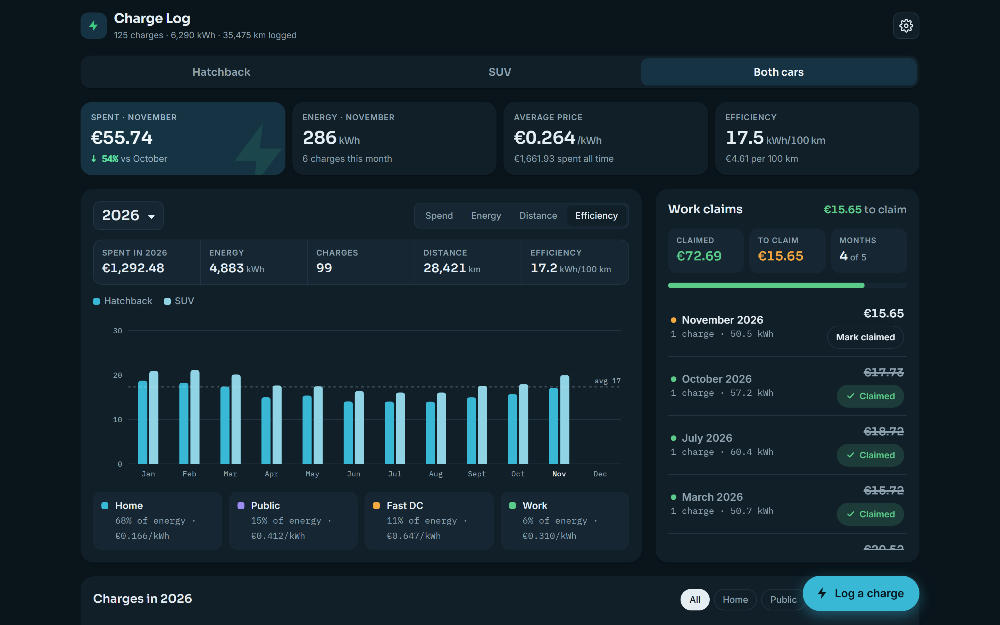<br><sub><b>Efficiency</b> per car, month by month</sub></td>
</tr>
</table>

Other styles in Settings: side by side, horizontal bars and a running total that builds up over the year.

### Month details

Tap or click any month for its own page: what it cost and how that compares with the month before and the same month last year, the split by charger type and by car, the work claim, and every charge. The arrows step through the months.

<table>
<tr>
<td width="68%">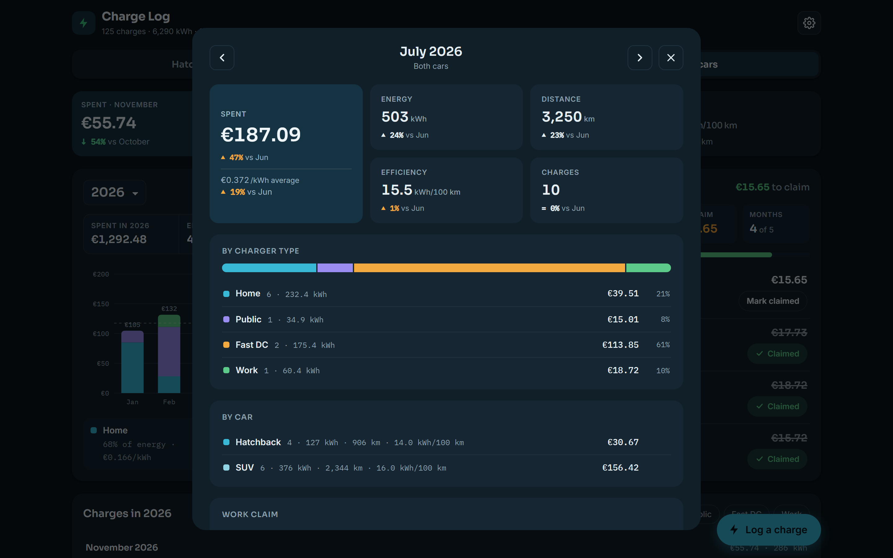</td>
<td width="32%"></td>
</tr>
</table>

### Logging a charge

One sheet, built to be filled in at the charger. The last odometer reading and the usual charger type are filled in for you, home charges are priced from the home electricity rate for that date, and a summary shows the cost, price per kWh and the distance since the last charge before you save. Likely typos, such as an odometer lower than last time, get a second look.

<p align="center">
&nbsp;&nbsp;
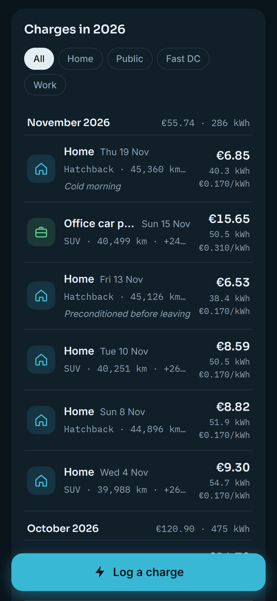
</p>

### Work claims

Charging paid for privately and claimed back from work is kept separately. Each month shows what is owed, a tap marks it as claimed, and if a charge is added to a month after claiming, the app points out the difference.

<p align="center">
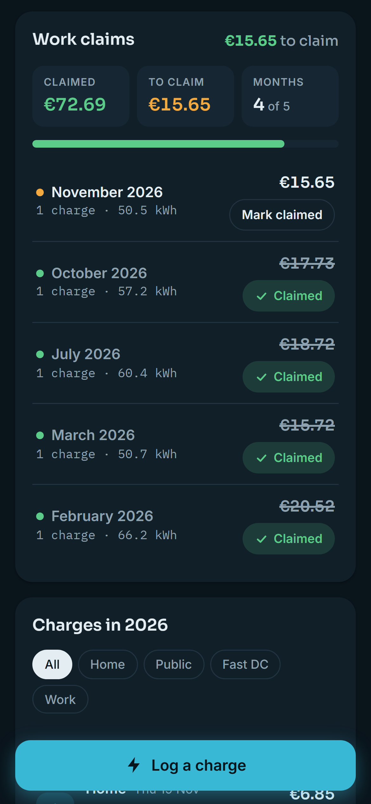
</p>

### Settings and themes

Currency, distance unit, a history of home electricity prices, theme, colour, chart style and car names.

<table>
<tr>
<td width="50%">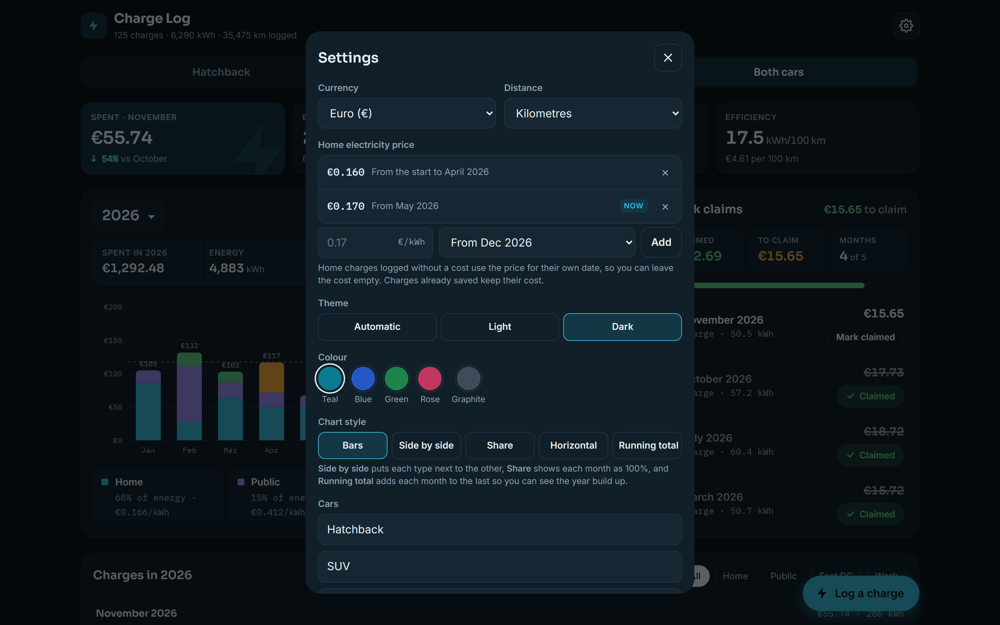</td>
<td width="50%">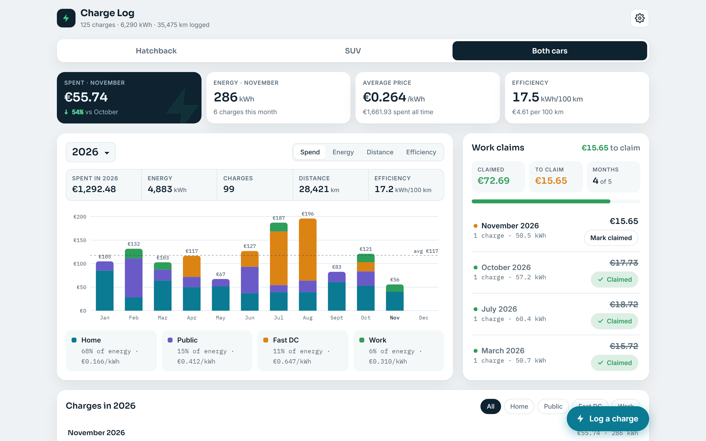</td>
</tr>
</table>

## Getting the app

### Phone

Open **[the app](https://davitos223.github.io/charge-log/)**, then add it to the home screen:

| iPhone (Safari) | Android (Chrome) |
|---|---|
| Share → **Add to Home Screen** | ⋮ menu → **Install app** / **Add to Home screen** |

It then opens full screen like a normal app.

### Windows

Download **`ChargeLog.exe`** from the [latest release](https://github.com/davitos223/charge-log/releases/latest) and run it. It needs nothing else installed. It opens the same app in its own window, so you only need to download it once.

## Updates

The app updates itself. Every change pushed to this repository goes live within a couple of minutes, and phones and the Windows app pick it up the next time they're opened. If a phone seems stuck on an older version, close the app fully and open it again. **Settings** shows the version at the bottom.

## Your data

Charges are stored in a private cloud database and only the logins that have access to a list can read it. Nothing is stored in this repository. **Settings → Save backup file** exports everything as a JSON file you can keep or load back in.

Without sync set up, the app still works and keeps charges on the device.

## How it works

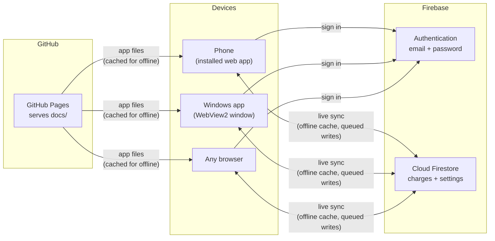

- **One app, everywhere.** The whole app is a single HTML file with no build step. GitHub Pages serves it, phones install it as a web app, and the Windows app is a small window around the same page, so one push updates every device.
- **Offline first.** A service worker keeps a copy of the app, so it opens with no signal or when GitHub is down. Firestore keeps a local copy of the data, so charges can be logged anywhere and upload when the connection returns.
- **Shared lists.** Each list belongs to one login. Other logins can be given access to it, and the database rules only let a login read and write lists it owns or has been given.

---

## For developers

<details>
<summary><b>Project layout</b></summary>

| Path | What it is |
|---|---|
| `docs/index.html` | The whole app: markup, styles and logic in one file, no build step |
| `docs/cloud.js` | Sign-in and sync (Firebase Authentication and Cloud Firestore with an offline cache) |
| `docs/config.js` | Which Firebase project to connect to; set it to `null` to run without sync |
| `docs/sw.js` | Service worker: offline support; opens the saved copy if GitHub is down, slow or showing an error |
| `docs/manifest.webmanifest`, `docs/icons/` | Installable app details and icons |
| `desktop/` | Windows wrapper (C#, WinForms and WebView2) that shows the live site in its own window |
| `screenshots/` | Images for this README, taken from a demo copy with made-up data |

GitHub Pages serves the `docs/` folder from `main`.

</details>

<details>
<summary><b>Running it locally</b></summary>

Serve the `docs/` folder with any static server, for example:

```
python -m http.server 5173 --directory docs
```

then open `http://localhost:5173`. With sync configured, a local copy connects to the same database as the live app, so sign in with a test account.

</details>

<details>
<summary><b>Releasing a change</b></summary>

GitHub Pages lets browsers cache each file for 10 minutes, so the page and its scripts are versioned together. On every release, change the version in all three places to the same value:

1. `APP_VERSION` in `docs/index.html`
2. the `?v=` on the `config.js` and `cloud.js` script tags in `docs/index.html`
3. `version` in `docs/cloud.js`

Then push to `main`.

</details>

<details>
<summary><b>Setting up your own sync</b></summary>

1. Create a Firebase project and add a **Web app** to it.
2. Turn on **Authentication → Email/Password**. It's best to turn off public sign-up so that only accounts you add can sign in.
3. Create a **Cloud Firestore** database in production mode.
4. Write security rules so that each signed-in user can only read and write their own data, plus any list that has been explicitly shared with them.
5. Put the web app's config in `docs/config.js`, and restrict its API key to your site's address in the Google Cloud console.

Each list lives under its owner's user ID. To share a list, the owner's settings name the other logins that may use it, and each of those logins points to the owner's list. Both are set in the Firebase console, never from the app.

</details>

<details>
<summary><b>Windows app</b></summary>

```
dotnet publish desktop -c Release -o desktop/publish
```

This builds a single self-contained `ChargeLog.exe` (.NET 8, WebView2). Rebuild it only when the wrapper itself changes. App changes reach it through the website.

</details>
